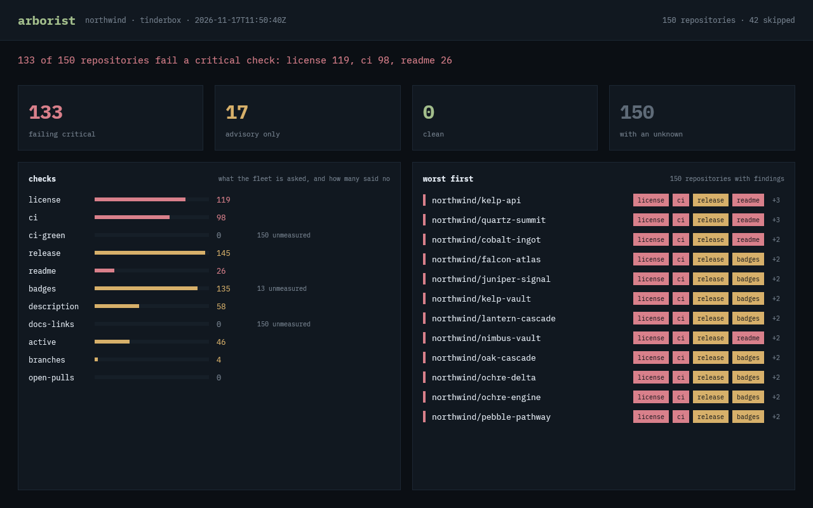

# arborist-view

The fleet as one frame. A GPUI Spore: it owns the view, the host owns the WebGPU
device and the compositor.

```sh
cargo build --release --target wasm32-wasip2
cp target/wasm32-wasip2/release/arborist_view.wasm module.wasm
soil spore run . --surface frame --frame /tmp/arborist.png --size 1280x800
```

`module.wasm` is built, not committed — 9.7 MB of GPUI and WebGPU that nothing
consumes without a host that can present it.



## What it draws

The same `arborist::Report` the command prints, rendered once:

- the headline sentence, which is the whole point of the tool;
- four numbers: failing critical, advisory only, clean, and unmeasured;
- every check with a bar, because the shape of the distribution is the argument;
- the repositories worth opening first, with their failing checks as chips.

It computes nothing. There is no second evaluator here — a wall that did its own
arithmetic would eventually disagree with the gate, and the wall is the thing
people believe.

## Two hosts, one view

`wall/` is the view — layout, colours, text, and nothing else. `browser/` and
the crate root are the two hosts that mount it:

| | renders into | boots with |
|---|---|---|
| the Spore (`view/`) | an offscreen texture, presented through `soil:present` | `wasm32-wasip2` + `gpui_wgpu` |
| the tab (`view/browser/`) | a WebGPU canvas the page owns | `wasm32-unknown-unknown` + `gpui_web` |

```sh
# the Spore
cargo build --release --target wasm32-wasip2
cp target/wasm32-wasip2/release/arborist_view.wasm module.wasm

# the browser build, and the glue the page imports
cd browser && cargo build --release --target wasm32-unknown-unknown
wasm-bindgen --target web --out-dir ../web --out-name arborist_web \
  target/wasm32-unknown-unknown/release/arborist_web.wasm
```

`web/` is what the web bridge serves at `/` — the page, the wasm-bindgen glue,
and the module. `gpui_platform`'s `multithreaded` feature is off: it needs a
nightly toolchain and a cross-origin-isolated page, and a wall renders on one
thread.

## Where the data comes from

`fixtures/fleet.json` is compiled in: a snapshot with the real fleet's shape and
invented names, because this repository is public and the fleet is not.

Fetching a live report over `soil:http` is the next step and is a change to where
`SNAPSHOT` is read, not to the view.
